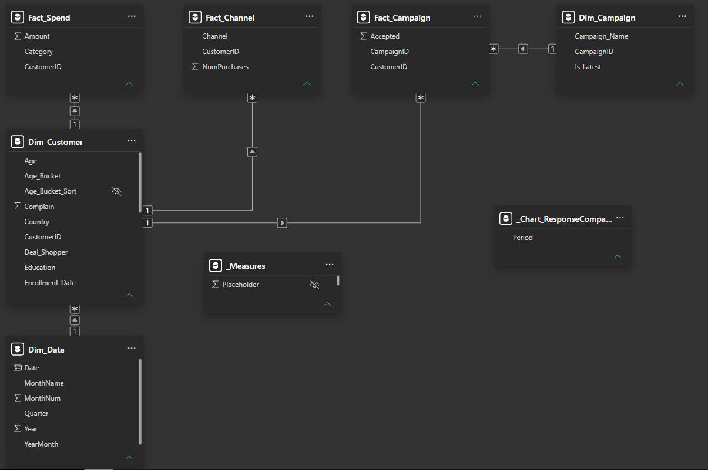
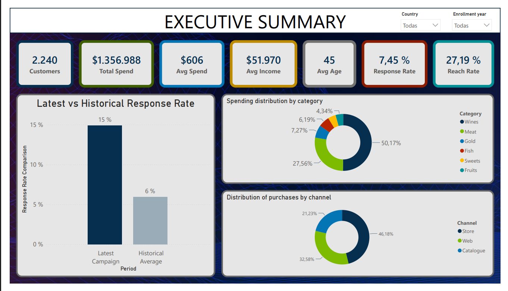
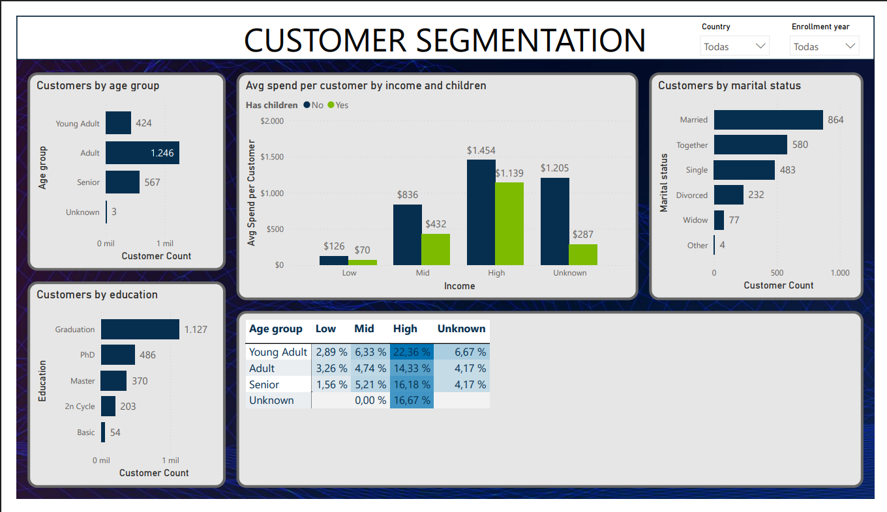
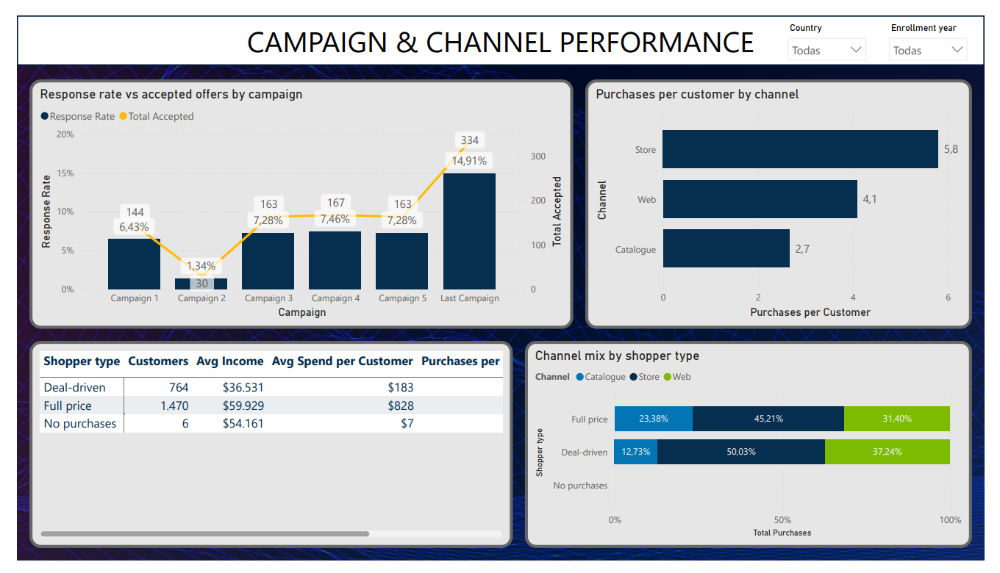
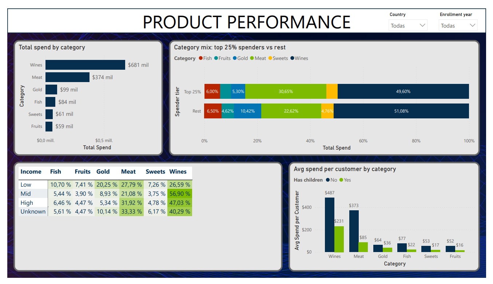
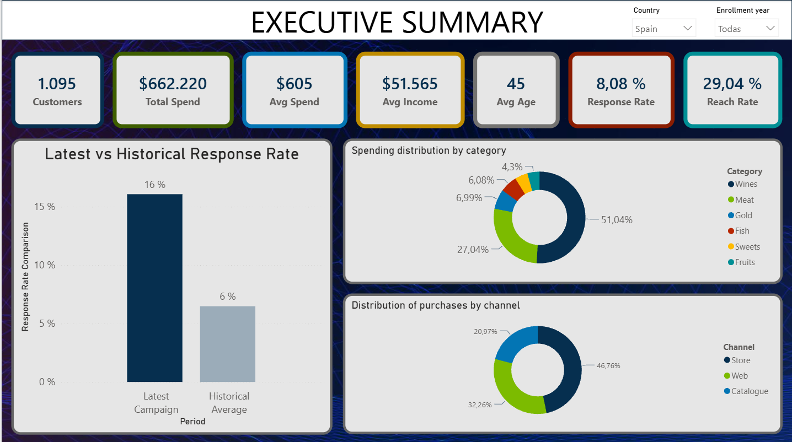

# Maven Market — Marketing Campaign Analysis

## Fuente y atribución

El dataset ([`data/raw/Marketing Campaign.xlsx`](./data/raw/Marketing%20Campaign.xlsx)) y el brief de proyecto original ([`docs/Project Brief - Marketing Campaign.pdf`](./docs/Project%20Brief%20-%20Marketing%20Campaign.pdf)) provienen de un caso de estudio público desarrollado originalmente por **Shahid Khan**:

- LinkedIn: https://www.linkedin.com/in/shahid-khan-791b78239/
- Kaggle: https://www.kaggle.com/shahidkhan01174
- Peerlist: https://peerlist.io/shahidkhan

Este proyecto retoma ese dataset para construir un modelo de datos y un análisis propio en Power BI, incluyendo una revisión crítica de algunas conclusiones del brief y análisis original (por ejemplo, re-evaluar qué campaña tuvo mejor desempeño usando tasas en vez de conteos brutos, y re-verificar si el canal Catálogo realmente está bajo rendimiento). Ver [`docs/04_business_questions.md`](./docs/04_business_questions.md).

## Objetivo

Analizar los datos de 2,240 clientes de una campaña de marketing — segmentación de clientes, rendimiento de canales y campañas, y desempeño de productos — para responder un set concreto de preguntas de negocio mediante un modelo de datos y dashboard en Power BI.

## Dataset

- **Fuente:** `data/raw/Marketing Campaign.xlsx`, hoja `marketing_data`.
- **Tamaño:** 2,240 clientes × 28 columnas.
- **Contenido:** demografía (edad, educación, estado civil, ingresos, país), gasto por categoría de producto (vinos, frutas, carne, pescado, dulces, oro), respuesta a 6 campañas de marketing, compras por canal (Web, Catálogo, Tienda).

## Modelo de datos

Esquema estrella/constelación propio, documentado con justificación de cada decisión de diseño:

- `Dim_Customer` (2,240 filas) — atributos demográficos y de comportamiento
- `Fact_Spend` (13,440 filas) — gasto por cliente × categoría de producto
- `Fact_Channel` (6,720 filas) — compras por cliente × canal
- `Fact_Campaign` (13,440 filas) — respuesta por cliente × campaña
- `Dim_Campaign` (6 filas), `Dim_Date`

Ver detalle completo en [`docs/05_data_model.md`](./docs/05_data_model.md).

## Limpieza y transformación de datos

- `Income` = 0 (24 filas) y outlier de $666,666 (1 fila) → recodificados a nulo
- `Year_Birth` implausible / edad 126+ (3 filas) → recodificado a nulo, fila retenida
- `Marital_Status` normalizado ("Alone" → "Single"; "YOLO"/"Absurd" → "Other")
- Resultado: 2,240 filas retenidas, 0 eliminadas

Ver detalle completo en [`docs/03_data_quality.md`](./docs/03_data_quality.md).

## Preguntas de negocio / páginas de dashboard planificadas

1. **Executive Summary** — KPIs generales: clientes totales, ingresos totales, tasa de respuesta a campañas, ingreso y edad promedio
2. **Customer Segmentation** — perfil demográfico, comportamiento de gasto por ingreso y presencia de hijos, segmentos más receptivos a campañas
3. **Campaign & Channel Performance** — campaña con mayor tasa de aceptación, canal con más compras por cliente, comportamiento de compradores con descuento
4. **Product Performance** — categorías con mayor gasto total y promedio, concentración de gasto por segmento

Ver detalle completo en [`docs/04_business_questions.md`](./docs/04_business_questions.md).

## KPIs o métricas

Valores sobre el total de la base (sin filtros):

| KPI | Valor |
|---|---|
| Clientes | 2,240 |
| Gasto total (2 años) | $1,356,988 |
| Gasto promedio por cliente | $606 |
| Ingreso promedio | $51,970 |
| Edad promedio | 45 |
| Tasa de respuesta (6 campañas) | 7.45% |
| Última campaña vs promedio histórico | 14.91% vs 5.96% |
| Clientes que aceptaron al menos una campaña | 27.19% |

## Capturas

Con `Country = Spain`, las tasas y los promedios se recalculan sobre el subconjunto:

## Herramientas y skills demostradas

- Power BI (modelado de datos, DAX, diseño de reportes)
- Modelado de datos (esquema estrella/constelación)
- Limpieza y transformación de datos
- Definición y priorización de preguntas de negocio
- Formato PBIP (modelo en TMDL + reporte en PBIR, versionable en git)

## Archivos relevantes

- `powerbi/maven_market.pbip` — proyecto Power BI (modelo + reporte de 4 páginas)
- `data/raw/Marketing Campaign.xlsx` — dataset original
- `docs/04_business_questions.md`, `docs/05_data_model.md`, `docs/03_data_quality.md`
- `docs/Project Brief - Marketing Campaign.pdf` — brief original (Shahid Khan)

## Estado

✅ Modelo, medidas DAX y reporte de 4 páginas completos.

Documentación completa en `docs/` (01 a 09), incluyendo diccionario de datos y conclusiones ([`docs/09_conclusions.md`](./docs/09_conclusions.md)).

## Cómo visualizarlo

Abrir `powerbi/maven_market.pbip` con [Power BI Desktop](https://powerbi.microsoft.com/desktop/) (gratuito, Windows). La ruta del Excel en la consulta `Src_MarketingData` es absoluta: si clonás el repo en otra carpeta, actualizala en Power Query antes de refrescar.
