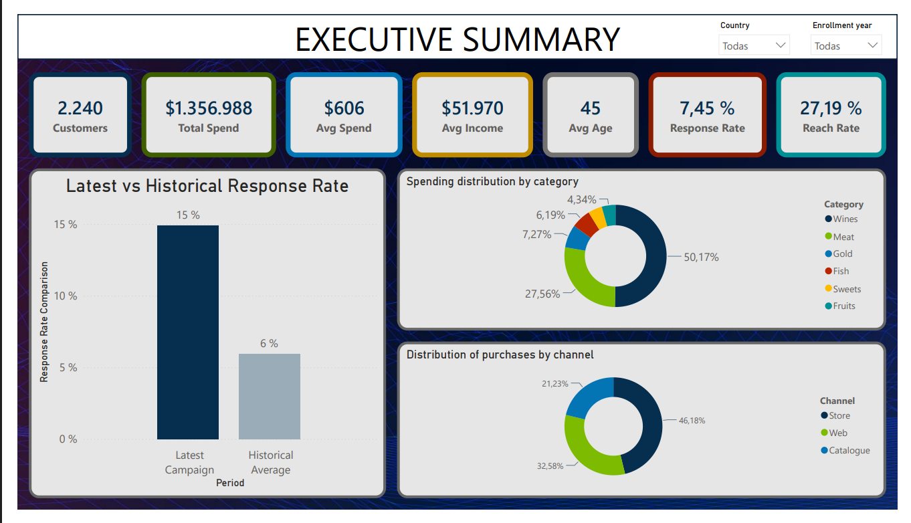

# Power BI Portfolio — Gregorio Ruiz

Portfolio de proyectos de análisis de datos y Business Intelligence, centrado en Power BI.
*Data analysis & Business Intelligence portfolio, focused on Power BI.*

## Sobre mí / About me

**ES** — Analista con background en marketing y más de una década transformando datos en decisiones. Experiencia construyendo dashboards, automatizando reportes y midiendo KPIs (ROI, CAC, CPL) con Excel, Power BI, Looker Studio y SQL. Orientado a resultados, con foco en storytelling de datos para negocio.

**EN** — Analyst with a marketing background and over a decade turning data into decisions. Experienced in building dashboards, automating reports, and tracking KPIs (ROI, CAC, CPL) using Excel, Power BI, Looker Studio, and SQL. Results-driven, with a focus on data storytelling for business.

**Ubicación / Location:** Barcelona, España. Disponibilidad presencial e híbrido en Barcelona, remoto en EMEA. · *Available on-site/hybrid in Barcelona, remote across EMEA.*

## Estado del portfolio / Portfolio status

**ES** — El primer proyecto (Maven Market) está completo: pipeline de Power Query, modelo estrella, medidas DAX y un reporte de 4 páginas, todo versionado en formato PBIP y documentado. Los demás proyectos son carpetas reservadas sin contenido aún.

**EN** — The first project (Maven Market) is complete: Power Query pipeline, star schema model, DAX measures, and a 4-page report, all versioned in PBIP format and documented. The other projects are placeholder folders with no content yet.

## Proyectos / Projects

| Proyecto | Carpeta | Estado | Notas |
|---|---|---|---|
| Maven Market | [`01_Maven_Market/`](./01_Maven_Market/) | ✅ Completo | Modelo estrella, medidas DAX y reporte de 4 páginas en PBIP, con documentación y conclusiones |
| Customer Churn | [`02_Customer_Churn/`](./02_Customer_Churn/) | 📁 Reservado | Carpeta creada, sin contenido aún |
| Supply Chain | [`03_Supply_Chain/`](./03_Supply_Chain/) | 📁 Reservado | Carpeta creada, sin contenido aún |
| Marketing Analytics | [`04_Marketing_Analytics/`](./04_Marketing_Analytics/) | 📁 Reservado | Carpeta creada, sin contenido aún |

---

## 01 — Maven Market

- **Objetivo:** Analizar los datos de 2,240 clientes de una campaña de marketing (segmentación, rendimiento de canales y campañas, y desempeño de productos) para responder un set concreto de preguntas de negocio con un modelo de datos y un dashboard en Power BI.
- **Fuente / atribución:** El dataset (`data/raw/Marketing Campaign.xlsx`) y el brief original ([`docs/Project Brief - Marketing Campaign.pdf`](./01_Maven_Market/docs/Project%20Brief%20-%20Marketing%20Campaign.pdf)) provienen de un caso de estudio público desarrollado originalmente por **Shahid Khan** ([LinkedIn](https://www.linkedin.com/in/shahid-khan-791b78239/), [Kaggle](https://www.kaggle.com/shahidkhan01174)). Este proyecto retoma ese dataset para construir un modelo y un análisis propios, incluyendo una revisión crítica de algunas conclusiones del brief original (ver [`docs/04_business_questions.md`](./01_Maven_Market/docs/04_business_questions.md)).
- **Dataset:** 2,240 clientes × 28 columnas (hoja `marketing_data`), con demografía, gasto por categoría de producto, respuesta a 6 campañas y compras por canal (Web/Catálogo/Tienda).
- **Power Query:** Pipeline en dos capas: staging con todas las correcciones de calidad y capa de modelo que arma el esquema estrella. Ver [`docs/06_power_query.md`](./01_Maven_Market/docs/06_power_query.md).
- **Modelo de datos:** Esquema estrella/constelación propio (`Dim_Customer`, `Fact_Spend`, `Fact_Channel`, `Fact_Campaign`, `Dim_Campaign`, `Dim_Date`), con la justificación de cada decisión de diseño. Ver [`docs/05_data_model.md`](./01_Maven_Market/docs/05_data_model.md).
- **Limpieza de datos:** `Income` en 0 (24 filas) y un outlier de $666,666, `Year_Birth` implausible (3 filas), normalización de `Marital_Status`. 2,240 filas retenidas, 0 eliminadas. Ver [`docs/03_data_quality.md`](./01_Maven_Market/docs/03_data_quality.md).
- **Medidas DAX:** Ver [`docs/07_dax_measures.md`](./01_Maven_Market/docs/07_dax_measures.md).
- **Reporte (4 páginas):** Executive Summary, Customer Segmentation, Campaign & Channel Performance y Product Performance.

**KPIs (total de la base, sin filtros):**

| KPI | Valor |
|---|---|
| Clientes | 2,240 |
| Gasto total (2 años) | $1,356,988 |
| Gasto promedio por cliente | $606 |
| Tasa de respuesta (6 campañas) | 7.45% |
| Última campaña vs promedio histórico | 14.91% vs 5.96% |
| Clientes que aceptaron al menos una campaña | 27.19% |

**Hallazgos principales:**

- La última campaña rinde unas 2.5× más que el promedio histórico; la Campaña 2 (1.34%) es la más débil.
- Solo el 27% de los clientes respondió alguna vez a una campaña: el alcance es el problema principal.
- El ingreso es el mejor predictor de respuesta (16.55% en ingresos altos vs 2.94% en bajos), y tener hijos en casa la reduce unas 3× incluso dentro del mismo tramo de ingreso.
- El Catálogo vende menos en volumen, pero es donde compran los clientes de mayor valor, así que no está claro que esté "rindiendo poco".

Conclusiones completas en [`docs/09_conclusions.md`](./01_Maven_Market/docs/09_conclusions.md) y limitaciones en [`docs/08_limitations.md`](./01_Maven_Market/docs/08_limitations.md).

- **Herramientas:** Power BI (Power Query, modelado, DAX, diseño de reportes), formato PBIP (modelo en TMDL + reporte en PBIR, versionable en git).
- **Cómo visualizarlo:** Ver las capturas en [`01_Maven_Market/images/`](./01_Maven_Market/images/) o abrir `01_Maven_Market/powerbi/maven_market.pbip` con [Power BI Desktop](https://powerbi.microsoft.com/desktop/). Detalle completo en el [README del proyecto](./01_Maven_Market/README.md).

## Próximos proyectos / Upcoming projects

`02_Customer_Churn`, `03_Supply_Chain` y `04_Marketing_Analytics` son carpetas reservadas para futuros proyectos. Aún no contienen archivos de trabajo, por lo que no se describe su alcance hasta tener contenido real.

*`02_Customer_Churn`, `03_Supply_Chain`, and `04_Marketing_Analytics` are placeholder folders for upcoming projects. They don't contain any working files yet, so their scope isn't described until there's real content to show.*

## Skills

Herramientas y competencias confirmadas por mí para este portfolio:

- Power BI
- DAX
- Power Query
- Excel
- Looker Studio
- SQL
- Modelado de datos (esquema estrella/constelación)
- Limpieza y transformación de datos
- Construcción de dashboards
- Automatización de reportes
- Análisis y seguimiento de KPIs (ROI, CAC, CPL)
- Storytelling de datos para negocio

## Cómo visualizar los proyectos / How to view the projects

**ES** — Cada proyecto incluye capturas en su carpeta `images/` para verlo sin instalar nada. Para explorar el reporte interactivo se necesita [Power BI Desktop](https://powerbi.microsoft.com/desktop/) (gratuito, Windows) y abrir el `.pbip` o `.pbix` del proyecto.

**EN** — Each project includes screenshots in its `images/` folder so it can be viewed without installing anything. To explore the interactive report, open the project's `.pbip` or `.pbix` file in [Power BI Desktop](https://powerbi.microsoft.com/desktop/) (free, Windows only).

## Contacto / Contact

- **Email:** grc90.rc@gmail.com
- **LinkedIn:** [linkedin.com/in/gregorioruiz](https://www.linkedin.com/in/gregorioruiz/)
- **GitHub:** [github.com/grc90](https://github.com/grc90)
- **Ubicación:** Barcelona, España — presencial/híbrido en Barcelona, remoto en EMEA
